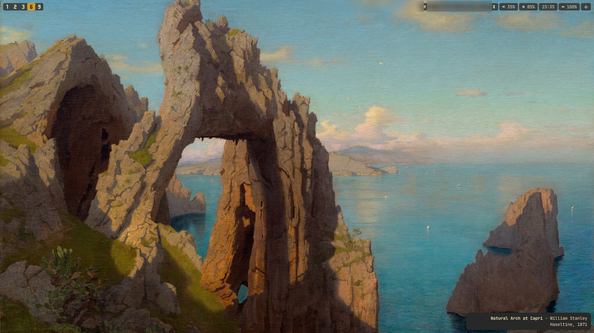

# artwall-hypr

Identifies the painting on your Hyprland desktop and labels it with a small overlay in the
corner of the screen. Matching is a cosine similarity search against a local CLIP index
built from open access museum collections. It runs on CPU in about a second, needs no
network once the index exists, and no image leaves the machine.



*The label sits in the bottom right. This wallpaper matched at 0.884, above the confident
threshold, so the painting is named outright.*

Wallpaper files are never modified. The text is drawn on a `gtk-layer-shell` surface above
the wallpaper, so the original image stays untouched on disk.

## How it works

```
[ active wallpaper ]
         |
         v
 +---------------+
 | SHA-256 cache | --(hit)--> show stored result
 +-------+-------+
         | (miss)
         v
 +----------------------+
 | local CLIP index     | --> score >= 0.88 : named as that artwork
 +----------------------+     score >= 0.78 : shown as "Reminiscent of ..."
                              below that    : shown as a resemblance, or nothing
```

1. The wallpaper file is hashed. A hash seen before skips straight to the stored result,
   so repeat wallpapers cost nothing.
2. CLIP (`ViT-B-32`, on CPU) embeds the image and compares it against a prebuilt matrix of
   museum artwork embeddings using cosine similarity.
3. The score decides how the result is phrased. A confident match is named outright and
   a fuzzy one is shown as a resemblance. Below that, `show_weak_matches` decides whether
   the nearest artwork is offered anyway or nothing is shown.
4. The title, artist and year go into the overlay.

Thresholds and fallback behaviour live in `artwall/config.py`.

## Requirements

* Hyprland, with `hyprpaper` setting the wallpaper
* Python 3.14 or newer
* System libraries: `gtk3`, `gtk-layer-shell`, `gobject-introspection`, `cairo`, `pkgconf`

On Arch:

```bash
sudo pacman -S gtk3 gtk-layer-shell gobject-introspection cairo pkgconf
```

## Installation

```bash
git clone https://github.com/Erzatskaiser/artwall-hypr.git
cd artwall-hypr
uv sync
```

That creates the virtualenv, installs the dependencies, and puts `artwall`,
`artwall-daemon` and `artwall-index` on the path inside it. PyGObject builds against the
system GTK libraries listed above, so install those first.

Without `uv`, a plain `python -m venv .venv && pip install -e .` works the same way.

## Building the index

Nothing can be identified until the local index exists. This downloads thumbnails from
open access museum APIs, embeds them, and writes the vectors to
`~/.cache/artwall/clip_index`:

```bash
uv run artwall-index
```

Sources are the National Gallery of Art, the Cleveland Museum of Art, the National Gallery
of Denmark, the Art Institute of Chicago, WikiArt, and the Met. A full run fetches roughly
15,000 artworks and takes a few hours, mostly waiting on rate limits. It can be
interrupted, and whatever has been indexed so far is saved.

For a subset, or a shorter run:

```bash
uv run artwall-index --sources nga,met --limit 500
```

## Running it

Once, against the current wallpaper:

```bash
uv run artwall          # -v shows match scores and timings
uv run artwall --clear  # take the overlay off screen
```

As a daemon that watches for wallpaper changes:

```bash
uv run artwall-daemon
```

To start it with your session, add this to `~/.config/hypr/hyprland.conf`:

```text
exec-once = /path/to/artwall-hypr/.venv/bin/python -m artwall.daemon
```

Inside an activated virtualenv the same commands work without the `uv run` prefix.

## Configuration

`artwall/config.py` holds the settings. The ones worth looking at first:

| Setting | Default | Meaning |
|---|---|---|
| `wallpaper_dir` | `~/Images/Wallpapers/paintings` | Wallpapers outside this directory are ignored |
| `show_weak_matches` | `True` | Show the nearest artwork below the fuzzy threshold, or say nothing |
| `confident_score` | `0.88` | At or above this, the artwork is named outright |
| `fuzzy_score` | `0.78` | At or above this, it is reported as a resemblance |
| `font_family`, `fg_color`, `bg_color` | Gruvbox | Overlay styling |
| `margin_x`, `margin_y`, `width_chars` | 10, 10, 45 | Overlay position and text width |

The wallpaper directory is compared after resolving symlinks, so pointing
`~/Images/Wallpapers` at a synced folder elsewhere works.

## Tests

```bash
uv sync --extra dev
uv run pytest tests/
```

## Limitations

* CLIP matches the image, so a cropped, recoloured or heavily filtered version of a
  painting can score below the confident threshold even when the work is in the index.
* The index only covers what the ingest sources publish. Anything outside it is shown as
  a resemblance at best.
* The overlay shows what the index knows, which is the title, artist and year. Earlier
  versions wrote a description with a local vision model; that was removed because it
  spun up a GPU for a desktop ornament. Richer detail, such as medium or collection,
  would be better taken from the museum APIs during ingest.
* The daemon polls `hyprctl` instead of subscribing to an event, because hyprpaper does
  not emit wallpaper change events.
* The overlay sits on the bottom layer, just above the wallpaper, so any open window
  covers it. It is meant to be read on an empty workspace.

## License

GPL-3.0. See [LICENSE](LICENSE).
